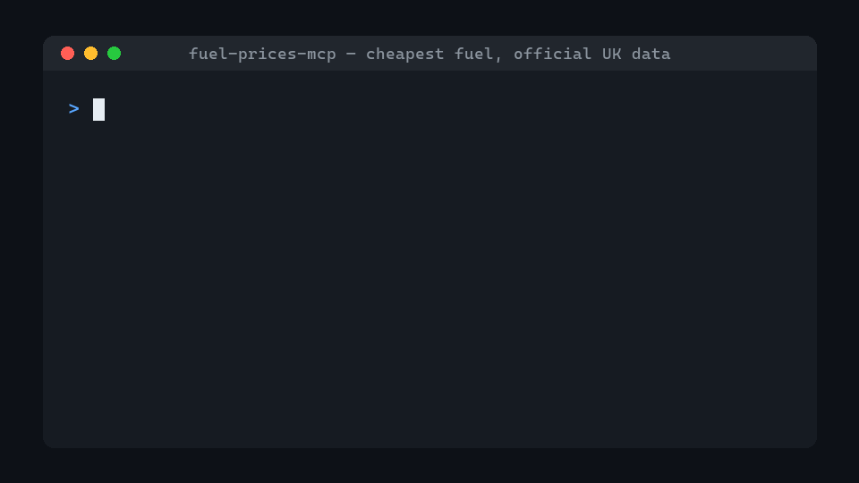

# fuel-prices-mcp

[](https://pypi.org/project/fuel-prices-mcp/) [](https://pepy.tech/project/fuel-prices-mcp) [](https://pepy.tech/project/fuel-prices-mcp)



**UK fuel prices MCP server** — ask Claude *"where's the cheapest unleaded near LL57?"* and get real answers from the official **Fuel Finder** open data: every UK forecourt, prices updated within 30 minutes of a change, as required by the Motor Fuel Price (Open Data) Regulations 2025.

**First of its kind:** the first MCP server for the UK's statutory fuel price scheme (as of July 2026 — the scheme itself only went live in February 2026). Free forever: government open data plus keyless postcode geocoding.

## Tools

| Tool | What it does |
|---|---|
| `fuel_find_cheapest` | Cheapest stations for a fuel near a postcode, ranked by price, each compared to the local median, with the tank-of-fuel savings spread |
| `fuel_nearby_stations` | Forecourts near a location, nearest first, with all fuel prices, brand and amenities |
| `fuel_area_summary` | Min/median/max per fuel for an area — "is 142.9 actually a good price here?" |
| `fuel_data_status` | Diagnostics: credentials configured, stations loaded, cache age |

Fuels: unleaded (E10), super unleaded (E5), diesel (B7), premium diesel, B10 and HVO. Prices are pence per litre. All tools read-only.

## Setup

### 1. Register for Fuel Finder access (free)

The API needs a GOV.UK One Login (free): [start here](https://www.developer.fuel-finder.service.gov.uk/fuel-finder/get-started-ifr/onelogin). You'll get an OAuth client ID and secret.

### 2. Install

```bash
uv tool install fuel-prices-mcp
```

### 3. Configure your MCP client

Claude Desktop (`claude_desktop_config.json`):

```json
{
  "mcpServers": {
    "fuelprices": {
      "command": "uvx",
      "args": ["fuel-prices-mcp"],
      "env": {
        "FUEL_FINDER_CLIENT_ID": "your-client-id",
        "FUEL_FINDER_CLIENT_SECRET": "your-client-secret"
      }
    }
  }
}
```

Claude Code:

```bash
claude mcp add fuelprices -e FUEL_FINDER_CLIENT_ID=... -e FUEL_FINDER_CLIENT_SECRET=... -- uvx fuel-prices-mcp
```

**Prefer not to keep credentials in a config file?** Set them as user environment variables instead (Windows: `setx FUEL_FINDER_CLIENT_ID "..."` in your own terminal; macOS/Linux: export them in your shell profile) and omit the `env` block entirely. The server reads them from the environment it inherits. Either way they never leave your machine, and if a secret is ever exposed you can regenerate it in the Fuel Finder portal.

## Example

> **You:** Cheapest diesel within 10 miles of CF10 1EP?
>
> **Claude** (via `fuel_find_cheapest`): The cheapest is 146.9p/litre at a supermarket forecourt 2.1 miles away — 5.0p under the local median. The spread in your area is 16.0p/litre, which is about £8.80 on a 55-litre tank, so it's worth the detour past the two nearest stations.

## How it works

The server fetches the full UK dataset (stations + prices, batch-paginated), joins it, and caches it in memory for 5 minutes — so repeated questions don't hammer the API while staying inside the Fair Use Policy's freshness expectation. Postcodes resolve via [postcodes.io](https://postcodes.io) (keyless); distances and statistics are computed locally. Permanently closed stations are excluded; prices older than 7 days are flagged as stale.

## Fair Use Policy compliance

This server is built to comply with the Fuel Finder Aggregator Fair Use Policy: prices are presented unbiased and ranked by objective criteria (price, distance), timestamps and metadata pass through unmodified, the in-memory cache refreshes within the policy's 5-minute freshness expectation, and every response includes the official [Report a Discrepancy](https://www.fuel-finder.service.gov.uk/motorist/price-report) link. If you build a public-facing service on top of this server, the Fair Use Policy applies to you directly — read it when you register.

## Limitations

- Prices are self-reported by forecourts under the statutory scheme; errors and lag happen — treat the pump price as final.
- The scheme covers road fuel at registered UK forecourts; it does not include EV charging or LPG prices.
- Postcode geocoding needs internet access to postcodes.io; `lat,lon` input works without it.
- Not affiliated with the CMA, DESNZ or GOV.UK.

## Privacy

Your credentials stay in your MCP client's config. Lookups go directly from your machine to the government API and postcodes.io — no third-party servers, no logging, no telemetry.

## Contributing

Issues and PRs welcome. Run the checks before submitting:

```bash
uv run pytest
uv run ruff check src tests
```

## Credits

Built by **Dwain Barnes / EryriLabs** — [HuggingFace](https://huggingface.co/EryriLabs). Contains public sector information from the [Fuel Finder scheme](https://www.developer.fuel-finder.service.gov.uk/), licensed under the [Open Government Licence v3.0](https://www.nationalarchives.gov.uk/doc/open-government-licence/version/3/). Geocoding by [postcodes.io](https://postcodes.io).
